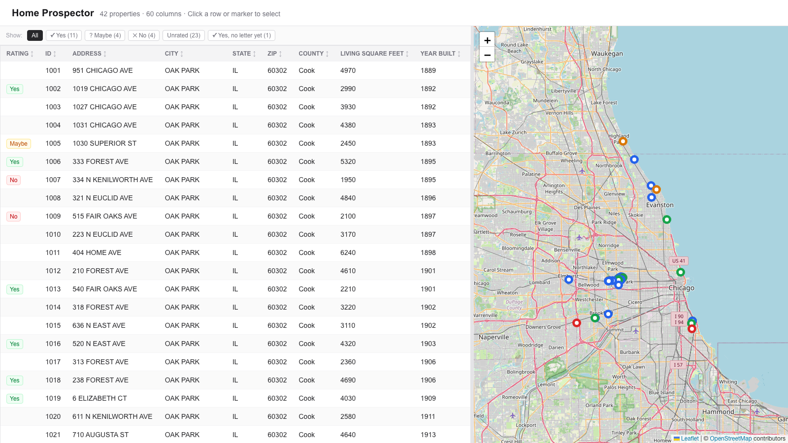

# Home Prospector

Find your next house before it hits the market: shortlist homes you love and write to their owners.



## How it's meant to be used

1. **Export candidates.** Use [Propwire](https://propwire.com) to pull every single-family home in the neighborhoods and price range you're interested in, whether or not it's listed, and export the list as CSV.
2. **Triage.** Go through them in a sortable table next to a map. Each home has a detail view with Zillow, Redfin and Street View links, plus the distance from where you are now. Rate each one **yes / maybe / no**.
3. **Write letters.** For the homes you said yes to, send the owner a short letter saying you love their house and asking whether they'd ever think about selling. Click **✉ Letter sent** to track your progress, and use the **Yes, no letter yet** filter to see who's left.

This helped me find my house.

## Features

- Sortable, filterable table of the full Propwire export
- Map with pins colored by rating (OpenStreetMap / Leaflet)
- Detail view with Zillow, Redfin, Google Maps and Street View links
- Distance from your current location (browser geolocation)
- Ratings and letter-sent flags saved to local JSON files

## Getting started

```bash
npm install
npm run dev
```

Open [http://localhost:3000](http://localhost:3000).

## Sample data

The repo ships with sample data in `data/` so the app works out of the box. The addresses are real, publicly documented **Frank Lloyd Wright–designed homes in the Chicago area**, and Year Built is Wright's design year. **Everything else is randomly generated and fictional**: owners, prices, specs, taxes, sale and mortgage history, and ratings. It does not describe the real properties or the people who live in them.

To regenerate it:

```bash
node scripts/generate-sample-data.mjs
DATA_DIR=data node scripts/geocode.mjs   # needs a Google Maps API key; see below
```

## Using your own data

1. Export a property list from Propwire as CSV.
2. Create a gitignored folder, for example `data-private/`, and save the export there as `propwire_export.csv`.
3. Point the app at it in `.env.local`:

   ```
   DATA_DIR=data-private
   NEXT_PUBLIC_GOOGLE_MAPS_API_KEY=your-key   # optional: geocoding + Street View
   ```

4. Geocode the addresses so they show up on the map:

   ```bash
   DATA_DIR=data-private node scripts/geocode.mjs
   ```

Ratings (`ratings.json`) and letter-sent flags (`addressed.json`) are written to the same `DATA_DIR`.
